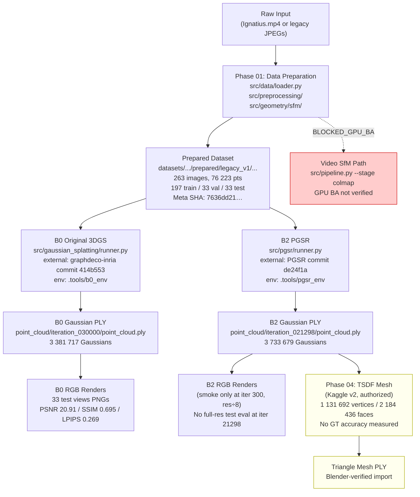

# 3DGS Mesh Reconstruction — Technical Reference

> **Snapshot date:** 2026-11-26.\
> This document describes the actual implemented and verified state of the repository.\
> Planned work is explicitly labelled **[PLANNED / NOT IMPLEMENTED]**.\
> All metric values are sourced from verified log files and experiment registry entries only.

---

## Table of Contents

1. [Project Overview](#1-project-overview)
2. [Complete Directory Structure](#2-complete-directory-structure)
3. [System Architecture and Pipeline](#3-system-architecture-and-pipeline)
4. [Implemented Models and Algorithms](#4-implemented-models-and-algorithms)
5. [Development Environment](#5-development-environment)
6. [Dataset and Data Management](#6-dataset-and-data-management)
7. [Training and Optimization](#7-training-and-optimization)
8. [Rendering and Mesh Extraction](#8-rendering-and-mesh-extraction)
9. [Evaluation Framework](#9-evaluation-framework)
10. [Existing Experimental Results](#10-existing-experimental-results)
11. [Execution Instructions](#11-execution-instructions)
12. [Current Issues and Technical Debt](#12-current-issues-and-technical-debt)
13. [Project Status Summary](#13-project-status-summary)

---

## 1. Project Overview

### Research Problem

Monocular video-based 3D scene reconstruction using **Gaussian Splatting** representations, with the goal of producing both high-quality novel-view synthesis and watertight surface meshes. The research compares multiple Gaussian-based methods on the **Tanks and Temples — Ignatius** scene and investigates geometry-regularised training as a pathway to better surface extraction.

### Objectives

1. Build a reproducible, single-scene reconstruction pipeline from COLMAP-prepared data to Gaussian models and triangle meshes.
2. Establish fair baselines for **B0 Original 3DGS** and **B2 PGSR** under identical data, split, seed, and resolution.
3. Prototype geometry-aware losses (depth/normal/NCC multi-view) on top of PGSR (B2) as a proposed method.
4. Extract surface meshes via TSDF fusion and evaluate against GT where available.
5. Report all results with full provenance, no metric fabrication, and explicit incompleteness flags.

### Input / Output

| Input | Output |
|---|---|
| Prepared COLMAP scene (images + sparse points + camera poses) | Gaussian PLY model (B0 or B2) |
| Frozen train/val/test split | Per-view rendered PNGs |
| Config YAML | PSNR / SSIM / LPIPS on 33 test views |
| (Phase 04 only) PGSR Gaussians + depth renders | TSDF triangle mesh (`.ply`) |

### Current Development Status

| Phase | Description | Status |
|---|---|---|
| Phase 01 | COLMAP data preparation, frozen splits, loader | **COMPLETE** |
| Phase 02 | B0 Original 3DGS training (local + Kaggle) | **COMPLETE** (30 000 iters, Kaggle) |
| Phase 03 | B2 PGSR training (Kaggle) | **PARTIAL** (21 298 / 30 000 iters) |
| Phase 04 | TSDF mesh extraction (Kaggle v2) | **DEMO** (mesh exists; no GT metric) |
| Phase 05 | Proposed geometry-aware PGSR variant | **[PLANNED]** |
| Phase 06 | B1 2DGS baseline; comparable runs | **[NOT IMPLEMENTED]** |
| Phase 07 | Final frozen evaluation and report | **[NOT IMPLEMENTED]** |

**Active blocker:** raw-video SfM pipeline remains `BLOCKED_GPU_BA` — GPU bundle adjustment has not been verified on this machine. All trained experiments use the **legacy image_set** COLMAP data (CPU BA, historical, explicitly authorised as a separate experiment).

---

## 2. Complete Directory Structure

```
3dgs-mesh-reconstruction/              ← project root
│
├── AGENTS.md                          ← stable agent instructions (read first)
├── README.md                          ← this file
│
├── src/                               ← all project Python source
│   ├── pipeline.py                    ← top-level orchestrator (SfM stages only)
│   ├── common/                        ← shared utilities (IO, telemetry, hashing)
│   ├── preprocessing/                 ← video frame extraction, keyframe selection
│   ├── geometry/sfm/                  ← COLMAP wrapper, GPU-BA gate
│   ├── data/                          ← prepared-dataset qualification and loader
│   │   └── loader.py                  ← frozen-split COLMAP adapter
│   ├── gaussian_splatting/            ← B0 Original 3DGS adapter
│   │   ├── runner.py                  ← training loop orchestrator
│   │   ├── checkpoint.py              ← save / restore / inspect full state
│   │   ├── config.py                  ← config loading and validation
│   │   ├── data.py                    ← scene adapter (wraps native reader)
│   │   ├── evaluation.py              ← per-split metric runner
│   │   ├── native.py                  ← CUDA extension loader
│   │   └── validation.py              ← PLY / checkpoint schema checks
│   ├── pgsr/                          ← B2 PGSR adapter
│   │   ├── runner.py                  ← training loop (geometry losses)
│   │   ├── checkpoint.py              ← full-state save/restore/inspect
│   │   ├── config.py
│   │   ├── data.py                    ← frozen-split adapter bypassing native destructive reader
│   │   ├── evaluation.py
│   │   ├── geometry.py                ← depth / normal / NCC multi-view objectives
│   │   ├── native.py
│   │   └── validation.py
│   └── evaluation/                    ← shared RGB metric utilities (PSNR/SSIM/LPIPS)
│
├── external/                          ← read-only third-party sources
│   └── PGSR/                          ← pinned commit de24f1a38b (plane rasterizer + simple-knn + GLM)
│
├── configs/
│   ├── sfm_ignatius.yaml              ← video SfM pipeline config (BLOCKED)
│   ├── data/
│   │   └── loader_references.json     ← dataset ID ↔ loader mapping
│   └── training/
│       ├── dependency_lock.json       ← B0 pinned deps (commit 414b553)
│       ├── pgsr_dependency_lock.json  ← B2 pinned deps (commit de24f1a)
│       ├── b0_smoke.yaml
│       ├── b0_low_memory.yaml
│       ├── b0_research_quality.yaml
│       ├── pgsr_smoke.yaml            ← 8-train-view/res÷8 diagnostics
│       ├── pgsr_low_memory.yaml
│       └── pgsr_research_quality.yaml ← full 1920×1080, seed 42
│
├── notebooks/
│   └── kaggle/
│       ├── phase02_resume_3dgs.ipynb  ← B0 Kaggle Run All
│       └── phase03_pgsr_run_all.ipynb ← B2 PGSR Kaggle Run All
│
├── scripts/
│   ├── kaggle/                        ← B0 Kaggle handoff helpers
│   ├── kaggle_pgsr/
│   │   └── setup_linux.sh             ← Kaggle Linux micromamba + PGSR CUDA build
│   ├── pgsr/
│   │   └── score_png.py               ← uint8-PNG-matched metric scorer
│   ├── visualization/
│   │   ├── phase02_pointcloud_review.py
│   │   └── phase03_pgsr_review.py
│   └── research/                      ← audit: discover.py, analyze.py, checkpoints.py, figures.py
│
├── datasets/
│   └── tanks_and_temples/
│       └── Ignatius/
│           ├── raw/                   ← IMMUTABLE: Ignatius.mp4, legacy JPEGs, GT mesh
│           └── prepared/
│               └── legacy_v1/
│                   └── ignatius-legacy-v1-6a3308c22df11122/
│                       ← 263 images 1920×1080, frozen COLMAP sparse model
│                       ← split: 197 train / 33 val / 33 test
│
├── outputs/
│   ├── tanks_and_temples/Ignatius/
│   │   ├── research/
│   │   │   ├── B0_3DGS/               ← all B0 run folders (5 runs, see §10)
│   │   │   └── B2_PGSR/               ← all B2 run folders (3 runs + recovery)
│   │   └── sfm_colmap/video_v0/       ← blocked SfM attempt outputs
│   ├── kaggle_download/               ← original local copies of Kaggle bundles
│   ├── kaggle_handoff/                ← handoff manifests for Kaggle runs
│   ├── phase03_handoff/               ← PGSR Kaggle handoff JSON
│   ├── phase03_session_safety/        ← Blender save before PGSR CUDA run
│   └── visualization/                 ← Blender .blend files and viewport screenshots
│
├── phase03_results/
│   └── recovery/run/                  ← SEALED: original flat PGSR Kaggle bundle
│       ├── checkpoints/iteration_021298.pth  (2.69 GB full state)
│       ├── point_cloud/iteration_021298/point_cloud.ply  (883 MB)
│       ├── training.jsonl, run.log, density.jsonl, …
│       └── segments/, preflight/
│
├── research/
│   ├── metadata/
│   │   └── experiment_registry.json   ← machine-readable record of all 8 experiments
│   ├── metrics/<experiment_id>/       ← full CSV loss histories per run
│   ├── comparisons/model_comparison.md
│   ├── figures/                       ← generated PNG/SVG plots
│   ├── cleanup/                       ← inventory, approval list, receipt
│   └── reports/
│       └── bao_cao_phan_tich_huan_luyen.md  ← formal Vietnamese scientific report
│
├── docs/
│   ├── README.md                      ← docs index (master navigation)
│   ├── RESEARCH_STATUS.md             ← compact verified status (authoritative)
│   ├── PROJECT_STRUCTURE.md           ← directory reading policy
│   ├── EXPERIMENT_REPRODUCIBILITY.md  ← reproducibility contracts
│   ├── plans/                         ← phase plans (master_plan.md, phase_01…07)
│   ├── architecture/                  ← system_architecture, data_flow, training_architecture, mesh_architecture
│   ├── tech/                          ← b0_training_usage, pgsr_training_usage, loss_logging, evaluation_specification, …
│   └── research/                      ← paper notes, proposed_method, literature_review, …
│
├── .tools/
│   ├── b0_env/                        ← B0 Python 3.10 venv (Windows, sm86)
│   └── pgsr_env/                      ← B2 Python 3.10 venv (Windows, sm86)
│
└── paper/                             ← 14 reference PDFs (read-only)
```

> **Large-asset summary:** `datasets/raw/` ≈ several GB (video + JPEGs + GT mesh, immutable). `outputs/` ≈ 30 GB (Gaussian PLYs, checkpoints, renders). `phase03_results/recovery/` ≈ 3.6 GB (sealed PGSR Kaggle bundle). `.tools/` contains full Python/CUDA environments (~4 GB). `external/PGSR/` is the pinned PGSR source tree.

---

## 3. System Architecture and Pipeline

### Pipeline Overview



### Stage Details

#### Phase 01 — Data Preparation (`src/data/`, `src/preprocessing/`)

- **Status:** COMPLETE (legacy image_set only; video SfM blocked).
- **Input:** Legacy JPEGs in `datasets/tanks_and_temples/Ignatius/raw/image_set/` + COLMAP DB and sparse model (CPU BA).
- **Process:** Qualification checks → frozen train/val/test split (8:1:1 by ordinal stride) → loader references published to `configs/data/loader_references.json`.
- **Output:** `datasets/.../prepared/legacy_v1/ignatius-legacy-v1-6a3308c22df11122/` — frozen snapshot with metadata SHA `7636dd21…` and split hash `fbd4eb56…`.
- **CLI:** `python -m src.pipeline --config configs/sfm_ignatius.yaml --stage preflight|preprocess|colmap --resume`
- **Note:** Video SfM exits with code `2` (`BLOCKED_GPU_BA`). Legacy data is a separately authorised experiment; it does not unblock video reconstruction.

#### Phase 02 / Phase 03 — Gaussian Training (`src/gaussian_splatting/`, `src/pgsr/`)

See §4 for per-method details.

#### Phase 04 — TSDF Mesh Extraction

- **Status:** DEMO (Kaggle v2 run, 2026-11-24 audit note).
- **Method:** CUDA-TSDF fusion over 197 integrated train-view depth renders from PGSR checkpoint 21 298.
- **Output:** Triangle mesh PLY — 1 131 692 vertices, 2 184 436 faces; Blender 5.2.3 import verified at identity transform.
- **No GT comparison** (Chamfer Distance / F-score) has been measured.
- **Project mesh extraction code:** **[NOT IMPLEMENTED]** in `src/`. Phase 04 was executed via a separate Kaggle notebook (version 2).

---

## 4. Implemented Models and Algorithms

### B0 — Original 3D Gaussian Splatting

| Property | Value |
|---|---|
| Paper | "3D Gaussian Splatting for Real-Time Radiance Field Rendering", Kerbl et al. SIGGRAPH 2023 |
| Official repo | `graphdeco-inria/gaussian-splatting` commit `414b553ef1d3032ea634b7b7a1d121173f36592c` |
| Project adapter | `src/gaussian_splatting/` |
| Native source | `external/` (pinned, read-only) or Kaggle dataset |
| Environment | `.tools/b0_env/` (Python 3.10, CUDA 12.1, PyTorch 2.4.1, sm86) |
| Config | `configs/training/b0_research_quality.yaml` |
| Entry point | `python -m src.gaussian_splatting.runner --config <cfg> --run <dir>` |

**Representation:** Each Gaussian is parameterised by position (xyz), covariance encoded as scale (3) + quaternion rotation (4), opacity (1), and spherical harmonics (SH degree 3 → 48 coefficients per channel = 144 floats). Stored as `binary_little_endian` PLY with 59 float properties per vertex.

**Training loop (native order):**
1. Random train-view sample (without replacement, stack-reset each epoch).
2. Tile-based differentiable rasterisation → RGB render.
3. Loss: $\mathcal{L} = (1 - \lambda_\text{dssim}) \cdot \mathcal{L}_1 + \lambda_\text{dssim} \cdot \mathcal{L}_\text{DSSIM}$, with $\lambda=0.2$.
4. Backward through rasteriser.
5. Adaptive Density Control (ADC): densify (clone/split) every 100 iters from iter 500 to 15 000; opacity reset every 3 000.
6. Adam parameter update (positions, features, opacity, scale, rotation).
7. Final iteration (30 000) skips Adam (native upstream behaviour).

**Checkpoint schema:** `b0-full-checkpoint-v1` — native `capture()` tuple (16 entries) + 6 Adam groups + ADC state + RNG (Python/NumPy/Torch CPU+CUDA) + sampler.

**Mesh:** No native mesh output. B0+TSDF is a declared diagnostic extension (D04 decision).

---

### B2 — PGSR (Planar-based Gaussian Splatting with Geometry Regularisation)

| Property | Value |
|---|---|
| Paper | "PGSR: Planar-based Gaussian Splatting for Efficient and High-Fidelity Surface Reconstruction", Chen et al. 2024 |
| Official repo | `zju3dv/PGSR` commit `de24f1a38b350387e8d8fe381b2cd70c1ae946e7` |
| Project adapter | `src/pgsr/` |
| Native source | `external/PGSR/` (read-only) |
| Environment | `.tools/pgsr_env/` (Python 3.10, CUDA 12.1, PyTorch 2.4.1+cu121, PyTorch3D 0.7.7) |
| CUDA extension | `diff_plane_rasterization._C` (hash `81aea1bf…`), `simple_knn._C` (hash `99ddba05…`) |
| Config | `configs/training/pgsr_research_quality.yaml` |
| Entry point | `.\.tools\pgsr_env\Scripts\python.exe -m src.pgsr.runner --config <cfg> --run <dir>` |

**Representation:** Same PLY structure as B0 plus plane-normal fields (nx, ny, nz). 62 float properties per vertex. Active SH degree 3.

**Training loop (native order, `src/pgsr/runner.py`):**
1. Train-view sample.
2. Plane rasteriser → RGB render + accumulated plane-depth + plane-normal.
3. **Loss components** (implemented in `src/pgsr/geometry.py`):
   - RGB: $(1-\lambda)\mathcal{L}_1 + \lambda \mathcal{L}_\text{SSIM}$ (canonical; always used).
   - Flatten/scale: $w_\text{scale}\sum_i \min(s_i)$ (reduces disc-like degenerate Gaussians).
   - Single-view depth-normal: $w_\text{sv} \cdot \bar{\mathcal{L}}_\text{SV}$ active from iter 7 000; full H×W mean, invalid pixels contribute 0.
   - Multi-view NCC: $w_\text{ncc} \cdot \bar{\mathcal{L}}_\text{NCC}$ active from iter 7 000; squared correlation, constant-patch rejection.
   - Multi-view geometric: $w_\text{geo} \cdot \bar{\mathcal{L}}_\text{geo}$ active from iter 7 000; homography consistency.
4. ADC: same schedule as B0 but with AbsGS abs-grad threshold and visibility trim; densification ends at iter 15 000.
5. Adam update (7 groups: xyz, knn_f, f_dc, f_rest, opacity, scaling, rotation).
6. Exposure model updated separately (AppModel).

**Weights (research quality):** $w_\text{scale}=100$, $\lambda_\text{dssim}=0.2$, $w_\text{sv}=0.015$, $w_\text{ncc}=0.15$, $w_\text{geo}=0.03$.

**Checkpoint schema:** `pgsr-full-checkpoint-v1` — 16-entry native capture + 7 Adam groups + exposure AppModel state + AppModel Adam + RNG (all 4 sources) + sampler remaining IDs.

**Data adapter (`src/pgsr/data.py`):** Bypasses PGSR's native destructive COLMAP reader (which would rewrite the sparse PLY and filter 19 249 extra points). Instead injects frozen metadata and train-only points from the prepared dataset. Camera W2C/focal parity is asserted.

**Geometry hardening (`src/pgsr/geometry.py`):** Finite positive depth, non-zero normal, non-parallel view, constant-gradient guard, undefined homography/border/constant-NCC rejection, connected-zero when empty. These are project overrides beyond upstream unguarded code.

**Exposure compensation:** AppModel (learnable per-train-image affine correction on colours) activated from iter 1 000. Val/test cameras have no exposure row; test scores use canonical frozen appearance.

---

### B1 — 2DGS

**[NOT IMPLEMENTED / NOT USED]** — roadmap baseline; no training run executed in this project. `docs/RESEARCH_STATUS.md` explicitly states: "2DGS has not been used in a project training run."

### B3 — GOF / Proposed Method ("Ours")

**[PLANNED, NOT IMPLEMENTED]** — Phases 05–07.

---

## 5. Development Environment

### Local Machine (Development / Low-Memory Training)

| Property | Value |
|---|---|
| OS | Windows 11 (PowerShell) |
| CPU | (not recorded in logs) |
| GPU | NVIDIA GeForce RTX 3050 6 GB Laptop GPU |
| GPU VRAM | 6 441 926 656 bytes ≈ 6 GB |
| CUDA Runtime | 12.1 |
| Python | 3.10.x |
| PyTorch | 2.4.1+cu121 |
| SM | sm_86 |

### Kaggle Training Environment (Research-Quality Runs)

| Property | Value |
|---|---|
| GPU | Tesla T4 |
| GPU VRAM | 15 636 037 632 bytes ≈ 14.6 GB |
| CUDA Runtime | 12.1 |
| Python | 3.10.20 |
| PyTorch | 2.4.1+cu121 |
| PyTorch3D | 0.7.7 (commit 8965341; pure-Torch CUDA transforms only) |
| OS | Linux (Kaggle container) |

### Project Virtual Environments

| Env | Path | Purpose |
|---|---|---|
| `b0_env` | `.tools/b0_env/` | B0 Original 3DGS training (Windows, sm86) |
| `pgsr_env` | `.tools/pgsr_env/` | B2 PGSR training, audit scripts (Windows, sm86) |

> **Never mix these environments in one process.** B0 and B2 have incompatible native CUDA extensions.

### Key Python Packages (both envs)

```
torch==2.4.1+cu121
torchvision
numpy
Pillow
lpips           # AlexNet weights, SHA-256 locked (see configs/training/)
tqdm
```

### CUDA Extensions

| Extension | Used by | Hash (Kaggle T4) |
|---|---|---|
| `diff_gaussian_rasterization._C` | B0 | (see `dependency_lock.json`) |
| `simple_knn._C` | B0, B2 | `99ddba05…` |
| `diff_plane_rasterization._C` | B2 | `81aea1bf…` |

Extension build hashes may differ between Windows (local) and Linux (Kaggle). The project verifies `native_revision` + Torch + CUDA runtime identity and requires a CUDA smoke pass before cross-OS resume.

### Build Tools

- MSVC 14.29.30133 (local Windows)
- GCC 12 / GXX 12 (Kaggle Linux, via Conda)
- Ninja 1.13.2

---

## 6. Dataset and Data Management

### Tanks and Temples — Ignatius

| Property | Value |
|---|---|
| Scene | Ignatius (outdoor statue) |
| Source | Tanks and Temples benchmark, legacy JPEG image set |
| Raw location | `datasets/tanks_and_temples/Ignatius/raw/` |
| Prepared location | `datasets/tanks_and_temples/Ignatius/prepared/legacy_v1/ignatius-legacy-v1-6a3308c22df11122/` |
| Total images | 263 |
| Resolution | 1920 × 1080 |
| Camera model | Pinhole (COLMAP) |
| Split | 197 train / 33 val / 33 test (ordinal stride, frozen) |
| Metadata SHA256 | `7636dd218be5cdb1bfa10b76b59a40b2b72cfb6129b0bf2d8fac4283a767913b` |
| Split SHA256 | `fbd4eb563ba6b5418165ce4d402e04ec123117f56b2fe0c601a35efaad3ba2b4` |
| Init SfM points | 76 223 (train-only) |
| Scene extent | 6.318 (nerf-normalization radius) |
| Coordinate system | COLMAP Hamilton WXYZ; W2C; x right / y down / z forward |
| Scale | Arbitrary monocular units (not metric) |
| GT mesh | Available in `raw/` for evaluation only; **not used in training** |
| GT availability | Evaluation-only; Chamfer / F-score not yet measured |

**Protocol disclosure:** Poses come from COLMAP bundle adjustment run on all 263 images (transductive, fixed-pose). Held-out test images' RGB values were accessible by the SfM process (not by training).

**PGSR data adapter note:** PGSR's native reader would destructively rewrite `sparse/0/points3D.bin` and filter extra points. `src/pgsr/data.py` bypasses this by injecting frozen prepared-dataset metadata directly.

---

## 7. Training and Optimization

### B0 Training Commands

```powershell
# Working directory: project root
# Environment: .tools/b0_env

# Smoke (1 200 iters, 12 views, res÷4, quick sanity check)
.\.tools\b0_env\Scripts\python.exe -m src.gaussian_splatting.runner `
    --config configs/training/b0_smoke.yaml `
    --run outputs/tanks_and_temples/Ignatius/research/B0_3DGS/<run_name>

# Low-memory (30 000 iters, all views, res÷4, Gaussian cap 250 000)
.\.tools\b0_env\Scripts\python.exe -m src.gaussian_splatting.runner `
    --config configs/training/b0_low_memory.yaml `
    --run outputs/.../<run_name>

# Research quality (30 000 iters, all views, res÷1 = 1920×1080, no Gaussian cap)
.\.tools\b0_env\Scripts\python.exe -m src.gaussian_splatting.runner `
    --config configs/training/b0_research_quality.yaml `
    --run outputs/.../<run_name>

# Resume from checkpoint
.\.tools\b0_env\Scripts\python.exe -m src.gaussian_splatting.runner `
    --config configs/training/b0_research_quality.yaml `
    --run outputs/.../<run_name> --resume

# Evaluate (renders test PNGs and computes metrics)
.\.tools\b0_env\Scripts\python.exe -m src.gaussian_splatting.runner `
    --config configs/training/b0_research_quality.yaml `
    --run outputs/.../<run_name> --stage evaluate
```

### B0 Key Hyperparameters (Research Quality)

| Parameter | Value |
|---|---|
| Iterations | 30 000 |
| Resolution | 1 (1920×1080) |
| SH degree | 3 |
| Seed | 42 |
| `position_lr_init` | 1.6×10⁻⁴ |
| `position_lr_final` | 1.6×10⁻⁶ |
| `lambda_dssim` | 0.2 |
| `percent_dense` | 0.01 |
| Densify from / until | 500 / 15 000 |
| Densification interval | 100 |
| Opacity reset interval | 3 000 |
| Checkpoint interval | 1 000 |

### B2 Training Commands

```powershell
# Working directory: project root
# Environment: .tools/pgsr_env

# Smoke (300 iters, 8 train views, res÷8)
.\.tools\pgsr_env\Scripts\python.exe -m src.pgsr.runner `
    --config configs/training/pgsr_smoke.yaml `
    --run outputs/tanks_and_temples/Ignatius/research/B2_PGSR/local-smoke-v1 `
    --stop-after 80

# Resume smoke
.\.tools\pgsr_env\Scripts\python.exe -m src.pgsr.runner `
    --config configs/training/pgsr_smoke.yaml `
    --run outputs/.../local-smoke-v1 --resume

# Evaluate smoke run
.\.tools\pgsr_env\Scripts\python.exe -m src.pgsr.runner `
    --config configs/training/pgsr_smoke.yaml `
    --run outputs/.../local-smoke-v1 --stage evaluate

# Research quality (30 000 iters, 1920×1080, all 197 train views)
.\.tools\pgsr_env\Scripts\python.exe -m src.pgsr.runner `
    --config configs/training/pgsr_research_quality.yaml `
    --run outputs/.../B2_PGSR/<run_name>

# PNG-matched metric scorer (required for fair comparison with B0)
.\.tools\pgsr_env\Scripts\python.exe scripts/pgsr/score_png.py `
    --run outputs/.../B2_PGSR/local-smoke-v1

# CUDA numerical tests (must pass before full run)
$env:PGSR_RUN_CUDA_TESTS='1'
.\.tools\pgsr_env\Scripts\python.exe -m pytest -q tests/test_pgsr.py
```

### B2 Key Hyperparameters (Research Quality)

| Parameter | Value |
|---|---|
| Iterations | 30 000 (session budget = 18 000 s on Kaggle) |
| Resolution | 1 (1920×1080) |
| `ncc_scale` | 1.0 (grayscale at 1920; not upscaled to 3840) |
| `multi_view_num` | 8 |
| Seed | 42 |
| `scale_loss_weight` | 100.0 |
| `single_view_weight` | 0.015 |
| `multi_view_ncc_weight` | 0.15 |
| `multi_view_geo_weight` | 0.03 |
| Geometry activation iter | 7 000 |
| Exposure from iter | 1 000 |
| Densify until iter | 15 000 |
| Max Gaussians cap | 6 000 000 |
| Checkpoint interval | 1 000 |

### Loss Logging

**B0 (`training.jsonl` per row):** `iteration`, `image_id`, `loss` (total), `psnr`, `ssim`, `gradient_norm`, `elapsed_seconds`, `position_lr`, `allocated_bytes`, `reserved_bytes`.

**B2 (`training.jsonl` per row):** `iteration`, `image_id`, `neighbor_image_id`, `loss` (total), `raw` (per-component: `rgb`, `flatten`, `single`, `multi_geo`, `multi_ncc`), `coefficients`, `weighted`, `gaussians`, `active_sh_degree`, `gradient_norms` (per-param), `elapsed_segment_seconds`, `position_lr`, `geometry_valid_pixels`, `multi_valid_pixels`, `ncc_candidate_patches`, `ncc_valid_patches`, `exposure_gate_used`, `allocated_bytes`, `reserved_bytes`, `peak_allocated_bytes`, `peak_reserved_bytes`.

> **Known gap:** PGSR does not log a standalone L1 or SSIM time-series. Additive exposure-loss history is absent. Validation LPIPS was not recorded. See `docs/tech/loss_logging.md`.

---

## 8. Rendering and Mesh Extraction

### RGB Rendering

**B0:** Native tile-based Gaussian rasteriser (`diff_gaussian_rasterization`). Renders float RGB; for metric comparison, results are rounded to uint8 PNG and re-loaded.

**B2:** Plane rasteriser (`diff_plane_rasterization`). Additionally outputs:
- `plane_depth` — accumulated planar depth, axial Z (H×W float32).
- `rendered_normal` — accumulated plane normal in camera frame (H×W×3 float32, unit after rendering).

The reload reference at export time (`reload_reference.npz`) stores RGB + depth + normal at a single val camera as a float32 reference for inference verification.

### PLY Export

Both methods export a `point_cloud.ply` after training. File format: `binary_little_endian 1.0`.

| Method | Properties per vertex | Size at 3.7 M Gaussians |
|---|---|---|
| B0 | 59 float32 (xyz + f_dc×3 + f_rest×45 + opacity + scale×3 + rot×4) | ~830 MB |
| B2 | 62 float32 (above + nx, ny, nz) | ~883 MB |

**NaN/Inf status (PGSR 21 298 PLY):** 0 NaN, 0 Inf verified in a 50 000-vertex head sample and 10 000-vertex tail sample.

### Mesh Extraction

**Project implementation:** **[NOT IMPLEMENTED]** in `src/`.

**Phase 04 (Kaggle v2, authorized):** CUDA-TSDF fusion over 197 train-view depth renders from PGSR checkpoint 21 298.
- Output: triangle mesh PLY — 1 131 692 vertices, 2 184 436 faces.
- Blender 5.2.3 import verified at identity transform; PLY SHA256 and ZIP integrity passed locally.
- **No GT accuracy metric** (Chamfer Distance, Precision, Recall, F-score) measured.
- The Kaggle v2 notebook scripts are not part of this repository's `src/` tree.

---

## 9. Evaluation Framework

### Implemented — RGB Metrics (`src/evaluation/`)

| Metric | Implementation | Notes |
|---|---|---|
| PSNR | `src/evaluation/` | From MSE on float renders; also from rounded uint8 PNG |
| SSIM | `src/evaluation/` | Native PyTorch/kornia; not identical to skimage default |
| LPIPS | `src/evaluation/` | AlexNet, `lpips` v0.1, locked weight SHA256 |

> **Comparison rule:** B0 scores use rounded uint8 PNGs. PGSR smoke has float-render diagnostics. Run `scripts/pgsr/score_png.py` to get PNG-matched B2 scores for fair comparison. Do not compare B0 PNG-scores directly to PGSR float-render diagnostics.

### Implemented — Periodic Validation

B0 runner saves `validation_<iter>.json` every 1 000 iters (PSNR + SSIM, no LPIPS, subset of val views).

### Implemented — Geometry Diagnostics (`evaluation/geometry_contract.json`)

Each train-view NPZ has `depth[H,W] float32` axial Z, `normal[H,W,3] float32` unit camera frame, `valid[H,W] bool`. Quantiles and unit-normal error are recorded as diagnostics — **not dense geometry accuracy**.

### Not Implemented / Missing

| Metric | Status |
|---|---|
| LPIPS periodic validation | Not recorded |
| B2 standalone L1 / SSIM time-series | Not logged |
| Chamfer Distance | Not measured (no alignment performed) |
| Accuracy / Completeness / F-score (GT mesh) | Not measured |
| Depth MAE / RMSE / AbsRel | Not measured |
| Normal Consistency / Angular Error | Not measured |
| FPS / Inference Time | Not measured |
| Multi-seed evaluation | Not run |

---

## 10. Existing Experimental Results

### Summary Table

All values are from verified log files and `research/metadata/experiment_registry.json`. Empty cells = not recorded.

| Experiment ID | Model | GPU | Iters | Resolution | Gaussians | PSNR | SSIM | LPIPS | Status |
|---|---|---|---|---|---|---|---|---|---|
| `b0-kaggle-c55f001d26` | B0 | Tesla T4 | 30 000 | 1920×1080 | 3 381 717 | **20.9130** | **0.6952** | **0.2694** | COMPLETED |
| `ignatius-legacy-b0-low-memory_…8ed1c6` | B0 | RTX 3050 6 GB | 30 000 | 480×270 (÷4) | 249 213 | 23.3754 | 0.8399 | 0.1150 | COMPLETED |
| `ignatius-legacy-b0-research-quality_…9ddaaa` | B0 | RTX 3050 6 GB | 7 400 | 1920×1080 | 2 379 021* | — | — | — | INTERRUPTED (BLOCKED_RESOURCE) |
| `ignatius-legacy-b0-smoke_…4ef4c4` | B0 | RTX 3050 6 GB | 0 | 480×270 | — | — | — | — | UNKNOWN |
| `ignatius-legacy-b0-smoke_…346824` | B0 | RTX 3050 6 GB | 1 200 | 480×270 | 78 582 | — | — | — | COMPLETED (smoke) |
| `kaggle-pgsr-geometry-smoke` | B2 | Tesla T4 | 300 | 240×135 (÷8) | 12 899 | 9.90† | 0.225† | 0.550† | COMPLETED (smoke) |
| `local-smoke-v1` | B2 | RTX 3050 6 GB | 300 | 240×135 (÷8) | 12 899 | — | — | — | COMPLETED (smoke) |
| `pgsr-kaggle-c269454133` | B2 | Tesla T4 | **21 298** | 1920×1080 | **3 733 679** | — | — | — | PARTIAL (session budget) |

*Gaussian count at last logged loss row, not a validated final model.\
†Smoke diagnostic at iter 300 and res÷8, 33 test views float-render scores — **not a research baseline**.

> **Important:** B0 low-memory scores (PSNR 23.4) are at resolution÷4 and **cannot be directly compared** to Kaggle full-resolution scores (PSNR 20.9). Different resolutions, different densification regimes.

### PGSR Partial Run Details (`pgsr-kaggle-c269454133`)

- **Termination reason:** Kaggle session budget exhausted (18 000 s limit).
- **Training time:** 17 457.8 s (measured PGSR segment; excludes setup/data qualification).
- **Geometry losses active:** Yes, from iter 7 000. Total geometry_valid_pixels: 29 521 427 959; NCC valid patches: 1 046 414 983.
- **Peak Torch allocated:** 9 382 MB; device-wide sampled: 11 591 MiB.
- **Full checkpoint verified:** `checkpoints/iteration_021298.pth` (SHA256 `ef82b72d…`, 2.69 GB) — 7 Adam groups, RNG all 4 sources, exposure 197 rows, optimizer_steps 21 298.
- **PLY:** `point_cloud/iteration_021298/point_cloud.ply` (SHA256 `3dc923…`, 883 MB, 0 NaN/Inf).
- **Resume readiness:** READY (requires same PGSR native revision + Torch + CUDA; different extension builds OK if CUDA smoke passes). **However:** the reorganised import folder is not directly resume-compatible with the current CLI layout; use original flat bundle at `phase03_results/recovery/run/`.
- **Mesh:** TSDF mesh extracted in separate Phase 04 Kaggle v2 run (1 131 692 vertices).

### Phase 04 Mesh

| Property | Value |
|---|---|
| Source checkpoint | PGSR iter 21 298 |
| Vertices | 1 131 692 |
| Faces | 2 184 436 |
| Integrated views | 197 (all train) |
| GT comparison | None measured |
| Blender import | Verified |

### Checkpoint Inventory (verified, `research/metadata/experiment_registry.json`)

| File | Iter | Method | Status |
|---|---|---|---|
| `b0-kaggle-c55f001d26/checkpoints/iteration_030000.pth` | 30 000 | B0 | Full state |
| `b0-kaggle-c55f001d26/checkpoints/iteration_029000.pth` | 29 000 | B0 | Full state (best val PSNR 20.88) |
| `ignatius-legacy-b0-low-memory_.../checkpoints/iteration_030000.pth` | 30 000 | B0 | Full state |
| `ignatius-legacy-b0-research-quality_.../checkpoints/iteration_007000.pth` | 7 000 | B0 | Full state (resume point) |
| `phase03_results/recovery/run/checkpoints/iteration_021298.pth` | 21 298 | B2 | Full state (sealed) |

Total: 58 checkpoint/weight files, 53 unique SHA256 hashes (from audit).

---

## 11. Execution Instructions

> All commands assume PowerShell, working directory = project root unless stated.

### 11.1 Environment Setup (Windows local)

```powershell
# B0 environment (already installed in .tools/b0_env):
.\.tools\b0_env\Scripts\python.exe --version  # verify Python 3.10

# B2 environment (already installed in .tools/pgsr_env):
.\.tools\pgsr_env\Scripts\python.exe --version  # verify Python 3.10

# To rebuild from scratch, see:
#   scripts/setup_pgsr.ps1  (B2 local)
#   scripts/kaggle_pgsr/setup_linux.sh  (B2 Kaggle)
```

### 11.2 Data Preparation

```powershell
# Dataset already prepared; do not re-run unless qualified:
# Prepared: datasets/tanks_and_temples/Ignatius/prepared/legacy_v1/ignatius-legacy-v1-6a3308c22df11122/

# Verify dataset integrity:
.\.tools\pgsr_env\Scripts\python.exe -c "
from src.data.loader import qualify
qualify('datasets/tanks_and_temples/Ignatius/prepared/legacy_v1/ignatius-legacy-v1-6a3308c22df11122')
"
```

### 11.3 B0 Training (Local Low-Memory, 30 000 iters, RTX 3050)

```powershell
.\.tools\b0_env\Scripts\python.exe -m src.gaussian_splatting.runner `
    --config configs/training/b0_low_memory.yaml `
    --run outputs/tanks_and_temples/Ignatius/research/B0_3DGS/<new_run_name>
```

### 11.4 B0 Training (Kaggle — Research Quality, 1920×1080)

1. Upload `outputs/kaggle_handoff/` checkpoint bundle to Kaggle dataset.
2. Open `notebooks/kaggle/phase02_resume_3dgs.ipynb` and run all cells.
3. Download `phase02_results_final.zip`, extract to `outputs/kaggle_download/`.
4. Verify checksums via `scripts/kaggle/import.py`.

### 11.5 B2 PGSR — Numerical Tests (required before training)

```powershell
$env:PGSR_RUN_CUDA_TESTS='1'
.\.tools\pgsr_env\Scripts\python.exe -m pytest -q tests/test_pgsr.py
```

### 11.6 B2 PGSR — Smoke Run (local)

```powershell
# First run (stop after 80 iters)
.\.tools\pgsr_env\Scripts\python.exe -m src.pgsr.runner `
    --config configs/training/pgsr_smoke.yaml `
    --run outputs/tanks_and_temples/Ignatius/research/B2_PGSR/my-smoke-v1 `
    --stop-after 80

# Resume to 300 iters
.\.tools\pgsr_env\Scripts\python.exe -m src.pgsr.runner `
    --config configs/training/pgsr_smoke.yaml `
    --run outputs/.../my-smoke-v1 --resume

# Evaluate
.\.tools\pgsr_env\Scripts\python.exe -m src.pgsr.runner `
    --config configs/training/pgsr_smoke.yaml `
    --run outputs/.../my-smoke-v1 --stage evaluate
```

### 11.7 B2 PGSR — Resume Kaggle Run (requires authorization)

```powershell
# Original flat bundle location:
# phase03_results/recovery/run/checkpoints/iteration_021298.pth

# Kaggle continuation: attach previous notebook output as Kernel Source,
# set PREVIOUS to recovery/, use same source capsule/config.
# See docs/tech/pgsr_training_usage.md §"Kaggle Run All" for details.
# DO NOT resume training without explicit user authorization.
```

### 11.8 PNG-Matched Scoring (B2, for fair comparison with B0)

```powershell
.\.tools\pgsr_env\Scripts\python.exe scripts/pgsr/score_png.py `
    --run outputs/tanks_and_temples/Ignatius/research/B2_PGSR/local-smoke-v1
# Output: rendering_metrics_png.json (uint8-matched, comparable to B0 metrics)
```

### 11.9 Research Audit Scripts

```powershell
$env:PYTHONUTF8='1'
$env:PYTHONDONTWRITEBYTECODE='1'
.\.tools\pgsr_env\Scripts\python.exe scripts/research/discover.py --hash-artifacts
.\.tools\pgsr_env\Scripts\python.exe scripts/research/analyze.py
.\.tools\pgsr_env\Scripts\python.exe scripts/research/checkpoints.py
.\.tools\pgsr_env\Scripts\python.exe scripts/research/figures.py
```

### 11.10 Video SfM (Currently Blocked)

```powershell
# DO NOT run without verifying GPU BA backend first:
python -m src.pipeline --config configs/sfm_ignatius.yaml --stage preflight --resume
# Returns exit code 2 (BLOCKED_GPU_BA) on this machine.
```

---

## 12. Current Issues and Technical Debt

### 12.1 Blocking Issues

| Issue | Location | Impact |
|---|---|---|
| `BLOCKED_GPU_BA` — GPU bundle adjustment unverified | `src/geometry/sfm/`, `configs/sfm_ignatius.yaml` | Video SfM pipeline cannot proceed; all training uses legacy image_set |
| PGSR 21 298 / 30 000 — partial run | `phase03_results/recovery/run/` | B2 baseline is not at full 30 000 iters; no full-resolution test-set evaluation |
| No GT metric for mesh | Phase 04 output | Cannot claim geometric accuracy; Chamfer / F-score unmeasured |

### 12.2 Reproducibility and Layout

| Issue | Detail |
|---|---|
| Reorganised PGSR import not resume-compatible | `outputs/B2_PGSR/pgsr-kaggle-c269454133/` has configs/logs split into subdirs; native runner expects flat layout. Original bundle at `phase03_results/recovery/run/` is the resume-compatible path. Do not delete it. |
| Duplicate data | `outputs/kaggle_download/` contains original Kaggle bundles that are exact duplicates of canonicalised run folders. See `research/cleanup/approval_required.csv` before any deletion. |
| Cross-OS resume caveat | PGSR full state saved on Kaggle Linux T4; restoring on Windows RTX 3050 requires same `native_revision` / Torch / CUDA and a passing CUDA smoke test. Extension build bytes may differ. |
| Single seed, single scene | All experiments use seed 42 and Ignatius only. No multi-seed or multi-scene validation. |

### 12.3 Metric and Logging Gaps

| Gap | Detail |
|---|---|
| No PGSR full-resolution test-set evaluation | At iter 21 298, no test-split render/score was produced on Kaggle |
| Missing LPIPS periodic validation | B0 validation JSONs have PSNR + SSIM only; LPIPS absent throughout training |
| Missing PGSR standalone L1 / SSIM series | PGSR logs total weighted loss; individual RGB components not separated |
| Smoke metrics not comparable to research baseline | Iter 300, res÷8, 8 train views — cannot substitute for 30 000-iter full-resolution scores |
| `rendering_metrics.json` vs `rendering_metrics_png.json` | Float-render diagnostics != uint8-PNG-matched scores; must not cross-compare |

### 12.4 Implementation Gaps

| Gap | Detail |
|---|---|
| B1 2DGS | Not implemented; roadmap only |
| Project mesh extraction (`src/`) | Not implemented; Phase 04 used an ad-hoc Kaggle notebook |
| GOF / "Ours" | Not implemented |
| Multi-view consistent evaluation protocol | Not established; Phase 07 |
| GT mesh alignment pipeline | Not implemented; required for Chamfer / F-score |

### 12.5 Data and Safety

| Issue | Detail |
|---|---|
| Transductive pose disclosure | COLMAP BA ran on all 263 images; held-out test RGB was visible to SfM (disclosed, not a training leakage) |
| Legacy CPU BA disclosure | Historical bundle adjustment used CPU BA (`ba_use_gpu=false`); not a strict GPU-verified reconstruction |
| Raw data immutability | `datasets/tanks_and_temples/Ignatius/raw/` and `phase03_results/recovery/run/` are sealed; never overwrite |

---

## 13. Project Status Summary

### Component Status Table

| Component | Method | Implementation | Tested | Available Outputs | Available Metrics | Known Issues |
|---|---|---|---|---|---|---|
| Video SfM | COLMAP + GPU BA | Implemented (wrapper) | BLOCKED | None | None | GPU BA not verified on RTX 3050 |
| Data preparation | COLMAP frozen split | Complete | Verified | Prepared dataset, split files | Metadata / split SHA | Transductive protocol disclosed |
| B0 Gaussian training | Original 3DGS commit 414b553 | Complete | CUDA smoke + 30 000 iters | PLY, checkpoints, PNGs | PSNR / SSIM / LPIPS | No periodic LPIPS; not paper-comparable |
| B2 Gaussian training | PGSR commit de24f1a | Complete | CUDA unit + 21 298 iters | PLY, full checkpoint | None (full-res) | 21 298 / 30 000 iters; no test eval |
| Geometry losses | depth / normal / NCC | Complete (src/pgsr/geometry.py) | CUDA finite-diff pass | Logged per-iter valid pixels | None | Not independently ablated |
| Mesh extraction | TSDF (Kaggle v2) | External (not in src/) | Blender import verified | Triangle mesh PLY | None (no GT) | No Chamfer / F-score |
| RGB evaluation | PSNR / SSIM / LPIPS | Complete (src/evaluation/) | Used in B0 test eval | Per-view + mean JSON | B0 full-res test scores | B2 full-res scores missing |
| Blender integration | KIRI addon | Operational | B0 PLY + B2 PLY imported | .blend scene file | None | Viewport preview ≠ metric render |
| B1 2DGS | — | NOT IMPLEMENTED | — | — | — | Roadmap only |
| GOF / Ours | — | NOT IMPLEMENTED | — | — | — | Roadmap only |
| GT mesh evaluation | Chamfer / F-score | NOT IMPLEMENTED | — | — | — | Requires alignment pipeline |
| Kaggle handoff | Notebook + scripts | Operational | B0 and B2 Kaggle runs complete | Manifests, import receipts | — | B2 stopped at session budget |

### Completed Functionality

- Frozen COLMAP prepared dataset with verified split and metadata hashes.
- B0 Original 3DGS: full 30 000-iter Kaggle training, full-state checkpoint, Gaussian PLY, RGB test evaluation (PSNR 20.91 / SSIM 0.695 / LPIPS 0.269 on 33 test views at 1920×1080).
- B0 low-memory local training (30 000 iters, res÷4).
- B2 PGSR: 21 298-iter Kaggle training with geometry losses active, full-state checkpoint verified, 3.7 M Gaussian PLY (NaN/Inf free).
- Phase 04: TSDF mesh from PGSR (1.1 M vertices; Blender-verified; no GT metric).
- Full provenance chain: experiment registry, loss histories, checkpoint audit, cleanup inventory.
- Blender 5.2.3 scene with B0 and B2 Gaussian point-cloud previews.

### Partially Completed Functionality

- B2 PGSR: 21 298 / 30 000 iters — requires another Kaggle session to complete.
- RGB evaluation for B2: smoke scores only (not full-resolution at iter 21 298).
- Video SfM: implemented but blocked on GPU BA.

### Unimplemented Functionality

- B1 2DGS (Phase 06).
- GOF / proposed method "Ours" (Phase 05).
- Project-side mesh extraction code (`src/`).
- GT alignment and geometry evaluation pipeline.
- Multi-seed / multi-scene experiments.
- Final frozen evaluation and formal comparison tables (Phase 07).

### Technical Blockers

1. **GPU BA verification** — video SfM pipeline cannot proceed.
2. **B2 30 000-iter completion** — requires explicit Kaggle re-run authorization.
3. **GT mesh alignment** — required before any geometry claim.

### Recommended Next Steps

1. Authorize PGSR continuation on Kaggle (use `phase03_results/recovery/run/` as `PREVIOUS`).
2. After 30 000 iters: run full-resolution test evaluation with `score_png.py`.
3. Implement GT mesh alignment and Chamfer / F-score pipeline.
4. Establish frozen evaluation protocol before modifying any metric definition.
5. Integrate B1 2DGS under a separate training request (Phase 06).

---

*All statements in this document are based on verified log files, JSON manifests, and source code in this repository. No metric values, checkpoint counts, or file contents have been fabricated. Unknown or unverified items are explicitly labelled.*
