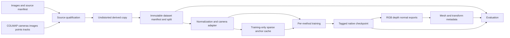

# Data flow và artifact lineage

Contract chi tiết: [data specification](../tech/data_specification.md), [reproducibility](../tech/reproducibility.md). Phase01 đã có loader/CLI/schema thực thi ngày15/11 tại [usage](../tech/phase_01_usage.md); downstream training/anchor/render/mesh schemas vẫn là **đề xuất**.

## Artifact map

| Artifact | Input lineage | Nội dung và consumer |
| --- | --- | --- |
| Qualification report | Explicit SfM model dir/image root + hashes | Source mode, diagnostics, conflicts, accepted/rejected IDs; Phase01 gate |
| Prepared dataset | Qualified model, images, transform/version | Undistorted image paths, intrinsics, poses, points, train/val/test IDs; mọi method dùng chung |
| Anchor cache | Prepared dataset + split hash | Train observations, transformed keypoints, z-depth, residual/track/angle; chỉ Ours/ablations |
| Run metadata | Dataset hash + method variant + profile + seed + revision | Native optimizer/checkpoint lineage, logs, resource limit changes |
| Render bundle | Checkpoint hash + camera set + renderer SHA | RGB; axial/ray depth label; normals frame/orientation; alpha/valid masks |
| Mesh bundle | Render bundle hoặc GOF field + extractor config | Raw/cleaned triangle mesh, units/transform, topology stats, checksums |
| Evaluation report | Frozen protocol + prediction + GT/evaluator metadata | Per-scene/view metrics, aggregation, failures; không trở lại training |

## IDs và graph integrity

`frame_id`, COLMAP `image_id`, `camera_id`, `point3D_id` khác nhau. Dùng mapping tường minh, không index array bằng rawID. Track references giữ `(image_id, point2D_idx)` và reciprocal association. Đổi undistorted coordinates phải lưu map và camera mới, không chỉ thay K trong JSON rồi dùng JPG distorted.

Legacy source không có timestamp/video hash cho từng ảnh được chứng minh: ghi `null`, `source_mode: image_set`; không suy timestamp từ `000001.jpg`. Video manifest có PTS/timebase; giữ original keyframe identity khi tạo derived images.

Split phụ thuộc accepted image list theo sort ổn định, không phụ thuộc filesystem enumeration. Confidence cache phụ thuộc **train split** nên không reuse khi split thay. Normalization tương tự một scene, không fit riêng từng baseline. Evaluation inverse transform trước metric units.

## Read/write protection và invalidation

`datasets/**/raw/`, existing SfM outputs/configs luôn read-only cho downstream. Derived dataset đề xuất `datasets/tanks_and_temples/Ignatius/prepared/<dataset_id>/`; run mới `outputs/tanks_and_temples/Ignatius/research/<run_id>/`. Đây là layout tương lai, không có artifact được giả tạo trong phiên này.

Thay camera/points/split/undistortion → dataset hash mới → invalidate anchors/checkpoints/renders/meshes. Thay mesher-only → mesh/evaluation mới, giữ training checkpoint nếu provenance khớp. Khi cache thiếu/hỏng: dừng và báo, không overwite experiment cũ hoặc tự xóa dữ liệu. Manifest ghi relative paths từ root và content hashes thay đường dẫn máy cá nhân.
