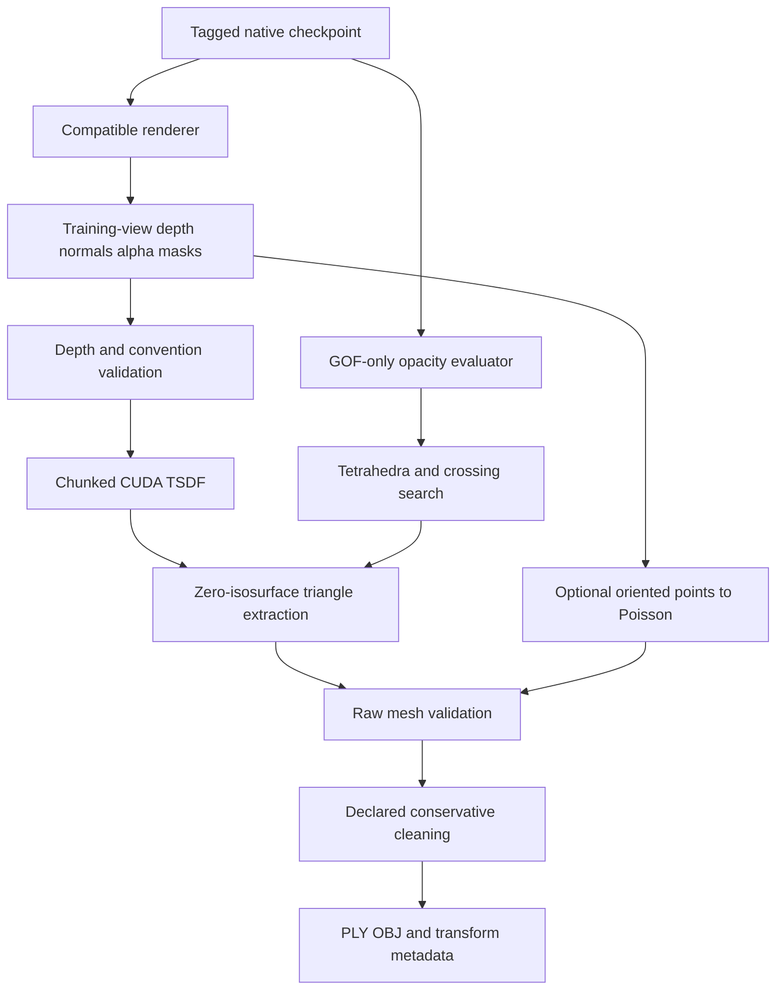

# Mesh architecture

Nguồn: P01 §6.1, P14 §V, P05 §4.5, P07 §3.4, P11 §4; [comparison](../research/method_comparison.md). Implementation chưa có. [Meshing spec](../tech/meshing_specification.md) quy định chi tiết buffers, backend và quality checks.

## Extraction ownership

Tách renderer adapter khỏi fusion backend. Adapter chịu trách nhiệm depth units/conventions, normal orientation, camera matrices và alpha validity. Mesher từ chối unknown/mismatched schema thay vì đoán. Native/common tracks xuất riêng và có cùng lineage tới checkpoint.

Main route B1/B2/Ours là depth→TSDF→isosurface. B0 không có native mesh; B0+TSDF cần depth extension ghi riêng. GOF dùng opacity field0.5; MILo dùng trainable signed scalars và in-loop supervision nên không nhận arbitrary PGSR checkpoint để “chạy MILo extraction”. Poisson là alternative reference, không implicit CPU fallback khi CUDA TSDF thiếu.

## Chunking và scene type

Bounded ROI + voxel-size đã cố định cho common comparison. Allocate sparse blocks hoặc tiles theo observed depth; stream một view/one chunk; free training state trước meshing. Chunk overlap phải ít nhất truncation band và extraction stencil; merge seams/deduplicate trong tolerance cùng scene units. Không fuse từng chunk không overlap rồi báo watertight.

Outdoor/unbounded scenes dùng bounded evaluation ROI hoặc scalable native route; không cấp dense grid vô hạn. ROI training/meshing được xác định từ train cameras/points, không dựa GT surface để tăng chất lượng. Official evaluation crop có thể dùng GT metadata **chỉ trong evaluator**, lưu phân biệt với meshing ROI.

## Cleaning/export contract

Lưu raw mesh và cleaned mesh riêng. Chỉ remove nonfinite/degenerate faces, duplicate vertices/faces theo tolerance khai báo; connected-component pruning phải công bố threshold/coverage impact. Không mặc định largest-component-only cho cả scene vì xóa disconnected objects hợp lệ. Hole filling/decimation là optional variants, lưu trước/sau stats và không dùng test GT để chọn.

PLY/OBJ phải có faces, finite geometry, indices đúng, normals hợp lý; Gaussian PLY và sparse PLY không đạt điều kiện triangle mesh. Export giữ arbitrary world coordinates mặc định; optional rigid display transform cho Blender lưu ma trận và inverse, không suy world-up từ convention camera y-down. Blender import smoke phải được thực hiện khi đến Phase04; phiên tài liệu chưa mở/sửa scene Blender.
