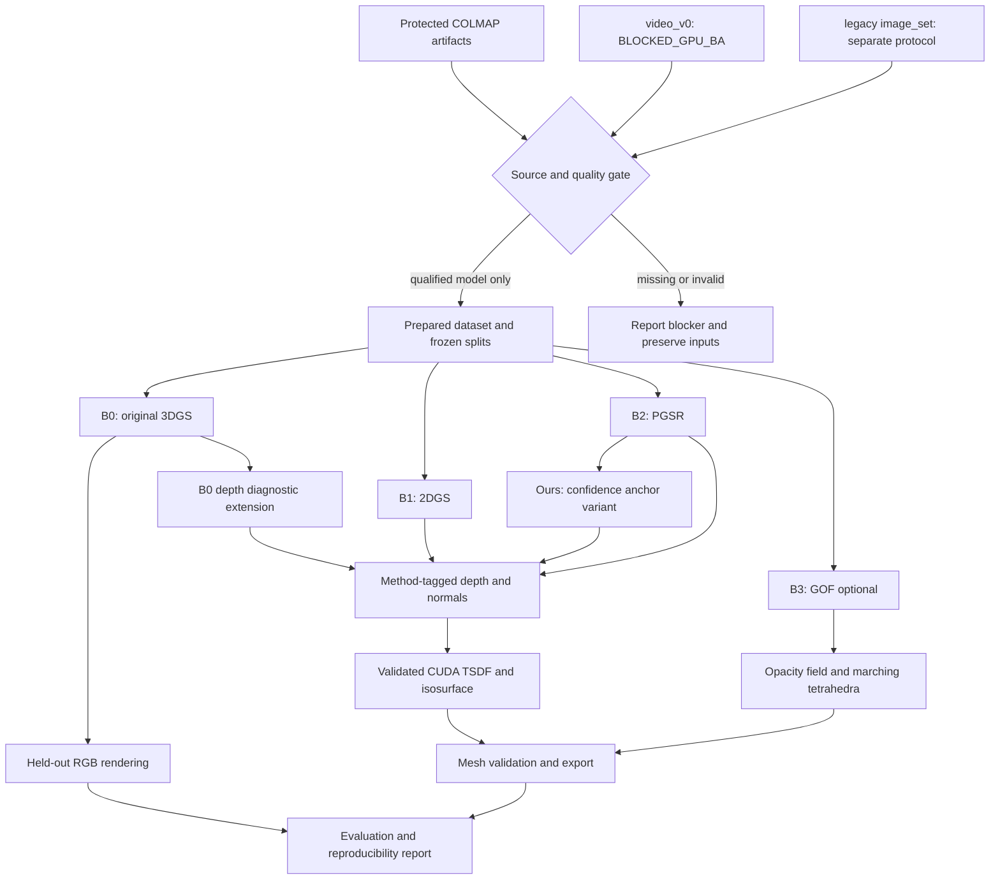

# System architecture

Thiết kế14/11/2026; cập nhật15/11: Phase01 `src/data/` và Phase02 B0 `src/gaussian_splatting/`/minimal RGB `src/evaluation/` đã triển khai theo request mới. [Phase01 report](../phase_01_implementation_report.md) giữ historical gates; [B0 usage](../tech/b0_training_usage.md) ghi actual native CUDA/training/metrics contracts. Các nhánh PGSR/2DGS/GOF/mesh chưa triển khai. [Repository audit](../repository_audit.md) giữ evidence lịch sử. Scientific choices: [comparison](../research/method_comparison.md). Nguồn mặc định vẫn video; prepared legacy là experiment riêng được user cho phép, không thay gate video.

## Boundaries và ownership

| Boundary / module dự kiến | Trách nhiệm | Không sở hữu |
| --- | --- | --- |
| Existing `src/geometry/sfm/` | Bảo toàn SfM/preprocessing provenance | Gaussian training hoặc mesh |
| `src/data/` khi Phase01 được yêu cầu | Read-only model adapter, undistortion copy, normalization/split/qualification | Rebuild poses/SfM, dùng GT |
| `src/gaussian_splatting/` khi Phase02/03 | Per-method adapter, renderer contract, optimizer/state | Tự thay dataset split/mesher để nâng metric |
| Geometry regularization module trong nhánh training | Fixed training-only anchors, loss inputs và diagnostics | Dùng held-out RGB/GT geometry |
| `src/mesh_reconstruction/` khi Phase04 | Export depth contracts, fusion/field extraction, cleaning/export | Nhận checkpoint không biết schema |
| `src/evaluation/` khi Phase07 | Frozen evaluator, alignment và metrics | Backpropagate/tuning model bằng test |
| `src/pipeline.py` tương lai | Dispatch stages và trạng thái | Monolithic algorithm implementation |

Đường dẫn mới chỉ là kế hoạch; không tạo placeholder source. Third-party code dùng dependency/adapters hoặc checkout versioned riêng khi cần, không copy các repo vào `src/`.

## State và quality gates

Mỗi stage giữ input/config/code/tool hashes, parent run IDs, outputs/checksums, backend và timings. `SUCCESS` là cục bộ stage. `FAILED`, `SKIPPED`, `BLOCKED_GPU_BA` giữ nghĩa existing code; downstream dự kiến thêm `BLOCKED_INPUT`, `BLOCKED_BACKEND`, `BLOCKED_RESOURCE` với reason rõ. Không truyền các status mới vào code cũ như thể đã hỗ trợ.

Gate G1: source/model qualified và không diagnostic fixture. G2: prepared dataset frozen, projection parity và split integrity. G3: renderer forward/backward CUDA verified trên subset. G4: checkpoints/resume/numeric checks. G5: depth definition/mesh backend verified. G6: evaluator units/alignment/masks locked. G7: final report phân biệt measured/paper/proposed.

GPU training/inference/rasterization/fusion đã chỉ định CUDA phải dừng nếu thiếu backend; không chuyển CPU. CPU được dùng đọc model, hash, decode, metadata, diagnostics và xử lý export nhẹ. GOF CGAL triangulation là CPU geometry component được công bố trong paper, không gọi toàn pipeline all-GPU. Xem [tech stack](../tech/tech_stack.md) trước quyết định backend.

## Scope hiện tại

Checkpoint documentation-first14/11 không tự cấp quyền execution; request mới15/11 đã cho phép Phase01 rồi **Phase02 B0 build/training/render/evaluation** trên prepared legacy experiment riêng. Scope hiện tại dừng sau Phase02, không PGSR/2DGS/GOF/mesh. Video vẫn thiếu qualified sparse model; sửa GPU BA là task riêng, không hidden prerequisite được thực hiện trong B0 adapter. Không chuyển VGGT/SLAM/customSfM để né blocker.
