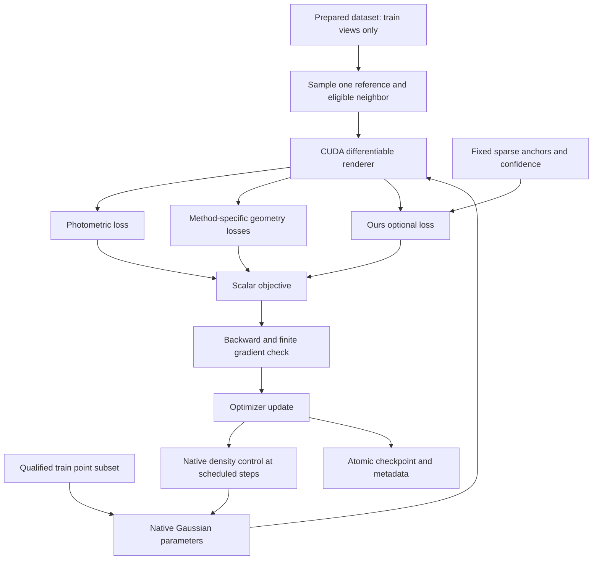

# Training architecture

Thiết kế dựa trên P02 §§3–6, P01 §§4–6 và P14 §IV; [review](../research/literature_review.md). P02/P01/P14 là method-specific, không một renderer universal. [Training spec](../tech/training_specification.md) là hợp đồng thực thi tương lai.

**B0 Phase02 actual path:** `src/gaussian_splatting` gọi pinned2023 native SceneInfo/cameras/GaussianModel/renderer/Adam/ADC; [usage](../tech/b0_training_usage.md) mô tả implementation. B1/B2/Ours trong sơ đồ đa phương pháp dưới đây vẫn planned. Sơ đồ tổng quát không quy định thứ tự native optimizer: verified B0 chạy **render → RGB loss → backward → collect screen-space gradients → native ADC/opacity reset → Adam (trừ final iteration) → checkpoint** theo selected `train.py`. Không tự reorder thành optimizer-before-ADC hoặc thêm geometry/exposure terms cho B0.

## Thành phần và state

ParameterStore sở hữu trainable means/scales/quaternions/opacities/SH và Adam state; row surgery khi prune/clone/split phải cập nhật optimizer tensors cùng row mapping. Renderer nhận camera convention đã chuyển rõ, trả buffers và visibility/radii/gradient hooks theo method. Loss module không tự thay camera poses hoặc dataset membership.

B0 chỉ RGB photometric; B1 thêm distortion/normal; B2 thêm flatten, single/multi-view và exposure theo **variant đã chọn**; Ours bắt đầu từ B2 cùng seeds/settings rồi bật anchors. B3 dùng renderer/evaluator khác và resource gate riêng. [Gaussian representation](../tech/gaussian_representation.md) cấm checkpoint interchange tùy tiện.

Loop sử dụng một full-resolution reference image/iteration theo budget; neighbor images tải lazily. CPU image I/O/short cache được phép, tensors tính loss/render/backward ở `cuda:0`. Không preload toàn bộ263 images vào VRAM. Không nạp monocular prior model cùng trainer; Ours v0 không có neural priors.

## Validation và exposure

Validation RGB render trong no-grad, fixed validation IDs và raw canonical appearance. Không tạo/tối ưu exposure embedding từ test RGB. PGSR exposure chỉ có train-camera variables; held-out default identity hoặc rule train-only đã preregister. Optional test-time fitted appearance metric là diagnostic khác, không primary NVS.

Snapshots chứa optimizer, scheduler/iteration, ADC accumulators, RNG Python/NumPy/TorchCPU/CUDA, activeSH degree, exposure state và all parent hashes. Resume không nạp chỉ Gaussian PLY rồi tự nhận exact continuation. Nondeterministic CUDA atomics phải nêu tolerance/variance; seed không bảo đảm bitwise identity.

## Memory và failures

Densification có transient peak do tensor copies, optimizer moments và tile duplication; Gaussian count cap không đủ đo tất cả VRAM. Dùng pre-insertion budget check, measured allocated/reserved và sampled device-wide metrics riêng. OOM → ghi failure/checkpoint, giải phóng, tạo variant config giảm memory theo [profiles](../tech/training_specification.md); không đổi research setting giữa B2/Ours mà không chạy lại comparison. Không nhảy Phase05 khi B2 chưa qua geometry và resume gates.
